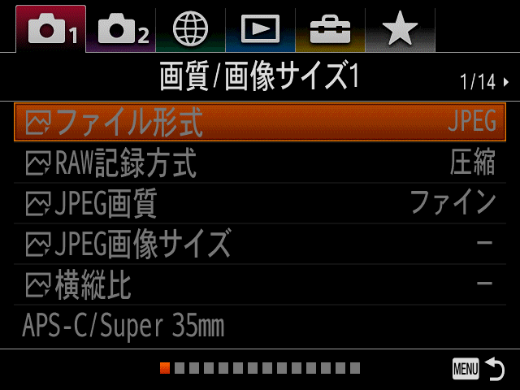

# A7 III QEMU 运行时（ILCE-7M3 4.04）

在 Linux 电脑的隔离 QEMU 中启动 Sony A7 III 4.04 原厂应用，进入原厂拍摄视图，并用窗口按钮打开 MENU。工程参考 [ZV-E10 QEMU](https://github.com/chocotan/zve10-qemu)，使用 A7M3 自己的固件、Linux 3.0.27 源码、设置模板和界面资源。

**当前验收（2026-11-04）：原厂拍摄视图入口、MENU、确认、返回和重新进入菜单已运行验证。拍摄视图目前只显示曝光补偿图标等少量状态；快门、光圈、ISO 等完整参数叠加尚未恢复。** 取景区域保持黑色，CMOS、镜头、对焦、拍照和录像没有实现。

| 原厂拍摄视图：当前显示范围 | 按 MENU 后的原厂菜单 |
| --- | --- |
|  |  |

两图来自同一次原固件运行。原 AP 生成页面、字体、图片和控件，软件后端消费绘图请求后，宿主通过 QMP 读取已完成的原生像素。主机窗口没有重新绘制相机菜单。截图摘要、输入和退出状态见[验收记录](validation/ui-acceptance.json)，移植过程及失败记录见[技术报告](report/2026-11-04-a7m3-qemu-bringup/README.md)。

## 启动窗口和进入菜单

需要 Linux x86_64、Python 3.10+、Pillow、Tk、pyelftools、ARM 交叉工具链，以及编译后的 QEMU 和 Sony 内核。固件和解包后的原厂程序不随仓库分发，首次使用按[准备与编译](docs/setup.md)完成环境。

在本目录运行：

```bash
./start.sh
```

窗口提供 **MENU、确认、返回、DISP、刷新**。键盘 `M` 请求 MENU，`Enter` 确认，`Esc` 返回，`D` 发送原 DISP 事件。原厂系统可能显示“当前此功能无效”，可用确认键处理；菜单参数修改及 DISP 的各档切换尚未作为已完成功能验收。

自动保存主页面与菜单截图并正常关闭 QEMU：

```bash
./start.sh --smoke
```

每次输出保存在独立的 `output/<时间>/`：

- `main.png`：当前原厂拍摄视图。
- `menu-before-confirm.png`、`menu.png`：MENU 与原确认事件之后的画面。
- `*.rgba4444`、`*.json`：原生像素、物理页映射及摘要。
- `serial.log`：原始启动、绘图和输入记录。
- `shutdown.json`：QEMU 退出状态。

窗口关闭时通过 QMP `quit` 结束自己启动的模拟器；连接失效会重连。关闭失败时保留进程所有权和可见错误，可再次关闭窗口重试。

## 下载全部 Sony 源码

Sony 官方页面：<https://oss.sony.net/Products/Linux/DI/ILCE-7M3_Ver404.html>

该页列出的 **25 个源码包**均已实际下载并校验，共 **263,513,506 字节，约 251 MiB**，包含 3 个 tar.gz 和 22 个 src.rpm；页面列出的不同版本全部保留。[完整下载清单](validation/source-downloads.json)记录每包的 URL、大小和 SHA256。

```bash
python3 scripts/download-sources.py
(cd sources/sony-ilce7m3-ver404 && sha256sum -c SHA256SUMS)
```

脚本默认将大文件写入被忽略的 `sources/sony-ilce7m3-ver404/`，使用临时文件和原子完成，拒绝 HTML 错误页，保留失败证据。本次工作区已有下载的位置、固件及构建工具的固定版本见 [SOURCES.md](SOURCES.md)。公开源码不等于 Sony 专有相机应用的完整源代码，原厂 UI 仍来自使用者自行提供的更新包。

## 已验证范围

| 项目 | 状态与内容证据 |
| --- | --- |
| 更新包身份 | 固定 EXE／DAT SHA256，内部版本 4.04，型号 `0x71030014` |
| 独立 QEMU | `-M a7m3`，九个 Sony 定时器、ARM Cortex-A9、PL011、GPE 启动模型 |
| 内核与模块 | 从 A7M3 官方 Linux 3.0.27 源码重建，模块 ABI 为 `3.0.27_nl-rt106+` |
| 原 AP | 原 `bootin.elf → im.elf`，图形和界面资源实际加载 |
| 拍摄视图入口 | 原 manager 创建 `view/ROOT → view/STLREC`，当前只显示少量叠加 |
| MENU | 原六个分类图标、日文标题、设置项和值可见；打开、返回、重进有原帧证据 |
| 输入 | 原 callback 按下／释放；MENU 另有原 UI 线程中的调度补偿，完整硬件输入路由未恢复 |
| 软件绘图 | 原 Bitmap/A8、LZ77、矩形、纹理、文字、清屏、present 和完成通知实际消费 |
| 窗口 | 实际 Tk 窗口的 MENU、确认、返回和正常关闭已验证 |
| 完整拍摄参数、菜单修改 | 尚未恢复／验收，部分项目显示不可用或空值 |
| CMOS、镜头、AF、拍照录像、虚拟 SD 成片 | 未实现，`capture_verified=false` |

取帧会等待原生产者完成，在 Bitmap 读锁下复制私有快照，暂停 QEMU 后按实际页映射读取，并独立核对指纹及 SHA256。它验证固件输出；没有以空成功返回或主机生成图片代替拍摄。

## 检查和复现

```bash
python3 tests/run-tests.py
python3 scripts/download-sources.py --self-test
./start.sh --smoke
```

需要显示服务时，可在 Xvfb 中验证实际窗口：

```bash
xvfb-run -a python3 tests/check-gui.py
```

主机回归覆盖软件绘图、帧存活期和重取帧、摘要错误拒绝、原厂 ABI、精确串口白名单、固件提取边界、设备节点以及 QMP 关闭失败重试。两个需要本地固件图片 fixture 的解码用例在缺少该资源时明确 skip，合成用例继续执行。结果摘要见 [validation/host-tests.json](validation/host-tests.json)。

## 运行边界与文档

- 只运行本机 QEMU，不连接相机，不直通真实 SD／物理磁盘，不刷机。
- 使用单 vCPU 和纯本地串口／QMP；未接入 guest 网卡或磁盘。
- 原更新包及分区提取结果保留，所有改动在生成的运行树和适配代码中完成。
- QEMU 设备及软件图像后端是明确的功能模型，未验证 Sony 物理 ASIC 的逐像素或寄存器等价性。
- 主页面完整状态、长时间多轮菜单稳定性和实际拍摄仍有边界，不将本版本描述为完整硬件仿真。

[准备与编译](docs/setup.md) · [技术报告与问题记录](report/2026-11-04-a7m3-qemu-bringup/README.md) · [UI 地址与完成通知适配](source/ui/PORTING.md) · [来源](SOURCES.md) · [第三方许可](THIRD-PARTY.md)
