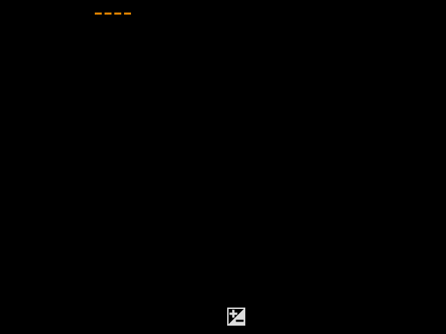
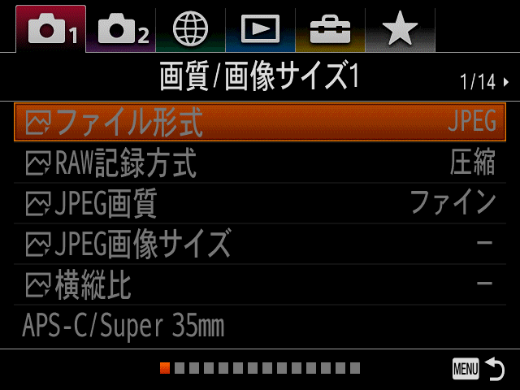

# A7M3 原厂拍摄视图与菜单的 QEMU 移植

2026-11-04，本机已用 ILCE-7M3 4.04 原始固件和该版本公开 Linux 源码构建独立 `a7m3` QEMU。原 AP 能创建 Root 与 STLREC，输出当前拍摄视图；原菜单的图标、字体、设置项和值可见，MENU、确认、返回及重进有实际帧证据。真实 Tk 窗口的按钮和正常关闭亦通过。

**主页面只恢复了少量状态叠加，完整快门、光圈、ISO 等参数尚未恢复。** 部分菜单项无效，长期多轮稳定性未验收。本成果不包含 CMOS、真实镜头、AF、拍照、录像或虚拟卡成片，`capture_verified=false`。用户授权及本机边界见 [scope.md](scope.md)。

| 本次原厂拍摄视图 | 本次原厂 MENU |
| --- | --- |
|  |  |

## 证据与复现

| Evidence | 来源与复现 | 内容校验 |
| --- | --- | --- |
| E-01 固件身份 | [准备工具](../../scripts/prepare-firmware.py)，官方 EXE→CAB→DAT→分区 | 固定 EXE、DAT SHA256，内部 4.04／`0x71030014`；见 [SOURCES.md](../../SOURCES.md) |
| E-02 全部公开源码 | [25 包清单](../../validation/source-downloads.json)，`python3 scripts/download-sources.py` | 每包大小、SHA256；25 包共 263,513,506 字节 |
| E-03 独立构建 | `build-kernel.sh`、`build-qemu.sh`，A7M3 3.0.27 和 QEMU 11.1.2 | QEMU 板级、定时器、无磁盘/网卡及 QMP quit 自检 |
| E-04 UI 地址 | [重定位报告](../../source/ui/relocation-report.json)，原 ELF 动态符号、RTTI、PC 相对引用及反汇编 | 两份原库 SHA256、14 个短 hook、RM literal trampoline 校验 |
| E-05 主机回归 | [回归结果](../../validation/host-tests.json)，`python3 tests/run-tests.py` | 13 组测试通过；固件图片 fixture 缺失的两个样本明确 skip |
| E-06 原帧和输入 | [UI 验收](../../validation/ui-acceptance.json)，`./start.sh --smoke` | 原生 RGBA4444、FNV、SHA256、PNG 逐像素还原、原按下/释放与完成通知 |
| E-07 真实窗口 | [窗口记录](../../validation/gui.json)，`xvfb-run -a python3 tests/check-gui.py` | 实际 Tk 按钮执行 MENU→ENTER→返回，WM_DELETE_WINDOW 之后 QEMU 正常退出 |
| E-08 收尾与提取边界 | [窗口及准备测试](../../tests/)，`python3 tests/test-camera.py` | 摘要错误不输出图、恢复执行、QMP 失效连接重连、关闭失败保留 owner；Python 3.10 兼容流式摘要 |

完整复现步骤见[准备与编译](../../docs/setup.md)。本机原始日志和失败输出保留在忽略的 `output/`、`evidence/`、`work/`；公开仓库保留源码、截图和有界摘要。可以用 `python3 tests/check-runtime-evidence.py output/<本次运行目录>` 对本机原始像素、图片、输入记录和退出码再核验。

## 主要问题和解决记录

### 更新包只能列出 PE overlay

`7z` 直接列出 EXE 时只看到包装器和 `[0]` 数据，不能直接得到 DAT。检查 Sony Packman 数据后确认其中是逐字节取反的标准 CAB；准备工具恢复 CAB，交给 7-Zip 提取 `FirmwareData_ILCE7M3V404.dat`，再用既有 fwtool 读取固件。全过程按数据解析，不执行更新器。

包装器元数据中有遗留的其他型号名称，因此使用完整包/DAT 摘要和内部固件元数据确认身份。原始 EXE 与分区镜像不改动，派生目录拒绝覆盖已有提取树。

### 同代内核能用，但必须用 A7M3 自己的源码重建

A7M3 与参考工程同为 ARM32、Linux 3.0.27。40 文件适配补丁可以干净应用到 A7M3 源码。首次 O= 构建被 Sony 归档自带 `.config` 拒绝；将该配置保全为 `work/sony-original-kernel.config` 后，独立构建成功。

原模块 ABI 和新内核均为 `3.0.27_nl-rt106+ SMP preempt mod_unload ARMv7`。实际 VM 的所需模块均加载成功。QEMU 注册、板级及定时器代码独立维护，不运行参考工程的二进制作为最终交付。

### 原 AP 启动后仍是空白根视图

`target=qemu` 能完成 AP 和图形初始化，但停在 RootSelector。适配在原 UI 线程请求 `view/ROOT`，待原 manager 创建后请求 `view/STLREC`。原 STLREC vptr 为 `viewUnified2+0x878328`，运行日志记录 manager 中实际创建的 `native.main.instance`。

这恢复了原厂拍摄页面入口，未伪造完整 CAMERA 属性。当前可见曝光补偿图标及少量状态线，完整拍摄参数仍是限制。

### 拍摄页使用了参考工程未覆盖的图像区和清屏布局

原 DMP 首次填充地址为 `0x32392200`，超出参考工程 `0x20000000..0x28000000` 的图像区。VM 改为保留 `0x20000000..0x40000000`，guest 映射、编码边界和 host 读取保持一致。

原拍摄页另提交了 layout=1 的整面均匀清屏。仅在完整表面、全不透明、无混合时处理；此操作在不同像素排列下具有相同字节结果。非线性局部绘图继续拒绝，并有回归用例覆盖，不把缺少的 ASIC 格式当成已经验证。

### MENU 回调送达后仍未切换页面

原输入表确认 MENU base=`0x15010110`，按下/释放为 `0x15010111/0x15010112`。本机接通 `InputService::callback_convert` 后，事件确实送出，但 AP-only 启动态没有完成 CP 的根状态推进。

最终保持原 callback，并将请求交给原 UI 绘图线程，调用 A7M3 自己的菜单 helper `viewUnified2+0x2bcfe1`。RootSelector 菜单接口子对象位于 `root+0x124`，与参考工程的 `+0x154` 不同，由 RTTI 确认。已存在的菜单不重复打开；返回使用原关闭页面请求。该补偿单独记入验收，不宣称原固件完整硬件输入路由恢复。

无硬件状态时原菜单可能显示“当前此功能无效”。ENTER 使用已核实的 `0x15010061/0x15010062`；真实按键和截图分别核对，提示不以假返回值吞掉。

### 第一张非空帧不足以验收界面

早期导出只抓到曝光图标或未完成加载的菜单。后来仅加延迟又会漏掉已经稳定不再重绘的 SID 页。最终在原生产者完成后保存最新有变化的私有快照，或按显式重取帧请求更新。

保留最近两份完整 snapshot，以覆盖 QMP 暂停发生在发布过程中的情况；host 暂停后排空发布，按 PFN 读取最近的完整快照，再核对内容指纹。读锁、原完成通知、帧存活期、内容变化、显式重取、页边界与摘要错误均分别测试。PNG 必须逐像素等于原 RGBA4444 的解码与透明度合成结果。

### 串口有输出，却没有输入消费

Sony UART 驱动的 console 默认会过滤输入。输入线程打开原 `ttyAM0` 后，通过原 `AMBAUART_IOC_SETMODE` 启用，再设为 raw 模式。命令使用精确长度白名单，拒绝嵌入 NUL 和额外文本；只发送确认过的原始逻辑事件。

最初使用新工具链 `clock_gettime` 导入了原 glibc 不具备的 `GLIBC_2.17`，原始加载失败已留存。最终移除该依赖，注入库仅需 `GLIBC_2.4`；实际原 glibc 2.11.2 可加载。

### QMP 失效连接和宿主 Tk 依赖

独立复核发现，重用超时 QMP stream 会导致关闭异常后窗口失去 process owner。现在关闭阶段重连、正常发送 quit 并等待退出；失败时窗口保留可见错误和 owner，可重试。回归覆盖故障及正常退出记录。

本机最初缺少 Tk 动态库，已安装与现有 Tcl 同版本的 Tk 8.6 后，再执行真实窗口验收。源码准备的摘要实现也改为流式版本，符合文档的 Python 3.10+ 要求。

## 主页面完整参数的剩余阻塞

`view/SID` 已在原 VM 中核实为 DISP 设置对话框，不能当作缺失的完整拍摄信息层，相关试验已撤回。

静态调查确认 CAMERA=`@M00B` 的原注册、`ModelCameraToInstance` 及初始化代码存在。注册受 Backup 项 `0x003e000b` 控制；本机实际读回为 1，选择集成的 `libObj.so`，不是缺失独立 `modelCamera.so` 的分支。另一次通过原 View 接口申请 CAMERA 返回 0，但没有改善图像，已移除该额外申请。

原状态 5 下的 `0x0f01` 初始化事务会进入 `ActionSetInit` 并批量读 Backup。其实际生命周期与 CP 参数推进尚未闭合。调查还发现原厂参数响应表入口，但没有注入虚构曝光、快门或 ready 响应来掩盖失败。进一步恢复参数应核对实例、状态及原初始化事务的实际消费。

## Findings 和路径

| Finding | severity | evidence_ids | confidence | location | status |
| --- | --- | --- | --- | --- | --- |
| F-01 独立内核和原 AP 启动 | n/a_re | E-01,E-03 | high | `source/kernel/`、`source/qemu/` | verified |
| F-02 原厂拍摄页已创建，参数不完整 | n/a_re | E-04,E-06 | high | `source/ui/ui-observe.c` | partial |
| F-03 原菜单实际绘图与输入补偿 | n/a_re | E-04,E-06,E-07 | high | `source/ui/`、`scripts/camera.py` | verified within stated scope |
| F-04 完整硬件及成片未实现 | n/a_re | E-06 | high | `validation/ui-acceptance.json` | not implemented |

P-01（callflow）：官方更新包→校验提取→原系统与 ALLLANG 模板→A7M3 内核与虚拟板→原 `bootin/im`→原 Root/STLREC→原输入 callback＋菜单 helper→软件后端消费原绘图→原完成通知→私有 snapshot→QMP 读取和独立摘要→真实窗口。

时间线：源码 25 包下载完成→A7M3 内核和独立 QEMU 构建→空白 Root 的原视图修复→图像地址与清屏布局修复→MENU 调度与原按键接通→最新完成帧及退出修复→真实窗口、原帧和内容核验→按发布白名单交付。
